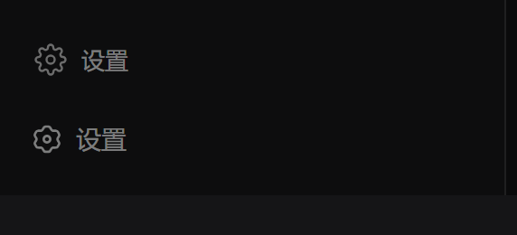
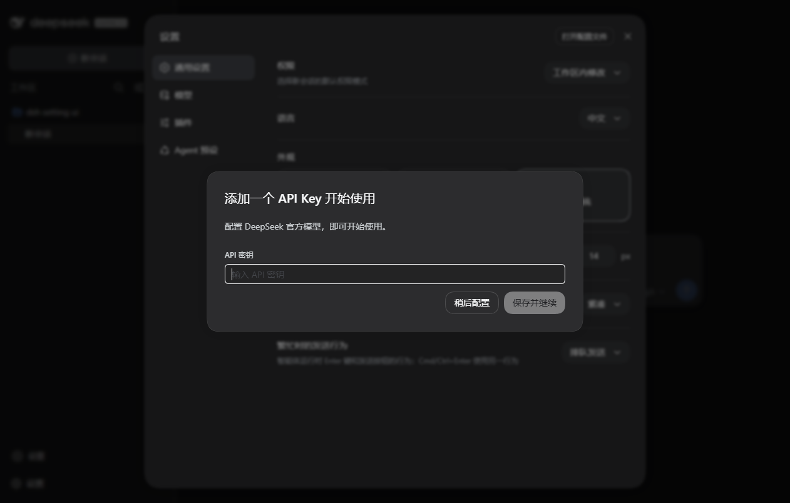

# dsh-sidebar-settings

把 DeepSeek Harness（DSH）的设置入口从「账号菜单 → 设置」的二级菜单里提出来，直接放到**侧边栏底部**：
点一下就打开设置面板，不必再先点账号头像。

A DeepSeek Harness **client plugin**: one settings button at the bottom of the sidebar, one click to the
settings panel — no more avatar menu → 设置.





> 截图来自本仓库的端到端验证：真实 DSH Web UI（临时 profile + Chrome CDP）里渲染按钮、点击、打开面板。

## 安装

插件以**本地目录插件**的形式装进 DSH profile（Windows 桌面端默认 profile 为 `desktop`）：

```powershell
# 在本仓库根目录执行（需要写入 <DSH_HOME>/profiles/desktop 的权限）
node scripts/install-desktop.mjs --dry-run   # 先看要改什么
node scripts/install-desktop.mjs             # 真正写入
```

脚本只做三件事，并把改动过的文件各备份一份为 `<file>.dsh-sidebar-settings.bak`：

1. 在 `<DSH_HOME>/profiles/<profile>/node_modules/dsh-sidebar-settings` 建立指向本仓库的 junction；
2. 在 profile 的 `package.json` 的 `dependencies` 里记录 `"dsh-sidebar-settings": "link:<本仓库路径>"`；
3. 把 `dsh-sidebar-settings` 追加到 `dsh.profile.bundles`（host 启动时按这个列表加载 profile 层）。

安装后**重启 DeepSeek Harness 桌面端**（客户端 bundle 在启动时装配）。
卸载：`node scripts/install-desktop.mjs --uninstall`。

其他 profile / 其他 DSH_HOME：

```powershell
$env:DSH_HOME = "C:\path\to\.dsh"; node scripts/install-desktop.mjs --profile web
```

## 使用

- 侧边栏底部多出一行「⚙ 设置」，点一下即打开设置面板；
- 侧边栏折叠成图标栏（rail）时只显示齿轮图标，鼠标悬停提示「打开设置 (Ctrl+,)」；
- 原有入口都保留：账号菜单里的「设置」、快捷键 `Ctrl+,`（Windows/macOS 桌面端）照常可用。

## 实现方式

插件只做两件事：注册一个座位、打开一个面板。

**1. 按钮放在哪** —— `sidebar.footer.action`（`list` 槽，多插件可共存，按 `order` 排序）。
它在侧边栏 footer 的 `footerActions` 区，紧贴在最底部的 `sidebar.settings` 行（账号菜单行）之上；
侧边栏折叠时 `wide: false`，我们渲染成居中的图标按钮。样式以一个带 `data-plugin` 标记的
`<style>` 注入（客户端模块加载器会接管它，卸载/热更新时自动移除），配色走 `--dsw-*` 主题变量。

**2. 怎么打开设置** —— 两条路径，先精确后兜底：

- **store 路径**（较新的外壳）：`@deepseek-ai/dsh-client-ui-settings-general` 注册 `sidebar.settings`
  时把设置外壳的 store 挂在该槽的 entry 上（`store.create()` 返回同一份 shell 实例）。
  我们通过 `ctx.slots.entries("sidebar.settings")` 取回它并调用 `actions.open()` —— 与原生齿轮按钮、
  `Ctrl+,` 命令、账号菜单里的「设置」走的是同一个 action。
- **DOM 兜底**（较旧的外壳，store 未公开）：直接点侧边栏设置行自己的控件 ——
  旧外壳那里是原生齿轮按钮（点一次就开）；新外壳那里是账号菜单触发器，于是再等一帧点掉菜单里的
  「设置 / Settings」项。全部基于 `[data-slot="..."]` 与 `aria-haspopup` 语义选择器，不依赖哈希后的
  CSS module 类名。

不用合成键盘事件：Windows/macOS 桌面端的快捷键由原生 preload 拦截，页面里派发 `keydown` 打不开设置。

## 开发

仓库零依赖，不需要打包器：`src/client.js` 直接以「客户端模块工厂函数体」的形式书写（CommonJS，
只 `require` 外壳提供的平台模块），构建脚本只做字符串包装 + 纯度和校验。

```powershell
node scripts/build.mjs     # src/client.js -> lib/client.js（window.__ModuleLoader__.load 包装）
node scripts/verify.mjs    # 契约测试：VM 里加载 bundle，验证注册、渲染、四条打开/兜底路径
```

端到端验证（可选，需要一个已装插件的 Web 实例 + 带调试端口的 Chrome/Edge）：

```powershell
# 1) 起一个临时 profile 的 Web 实例，避免影响正在用的桌面端
$env:DSH_HOME = "$env:TEMP\dsh-verify"; dsh --profile verify --port 4779 --no-open
# 2) Chrome 打开 http://127.0.0.1:4779/?token=... 并带上 --headless=new --remote-debugging-port=9333
node scripts/probe-ui.mjs --cdp 9333 --shot lib/probe.png
```

`probe-ui.mjs` 会等到按钮出现、打印它的标签/位置、截侧栏底部特写，点击按钮后确认设置面板打开（否则退出码 1）。

## 目录

```
cordis.patch.yml        profile 层 patch：插入插件行
lib/index.js            host 侧加载行（本插件不占 host 服务，apply 为空）
lib/client.js           构建产物：浏览器端 bundle（已提交，安装时无需构建）
src/client.js           浏览器端源码（factory body 形式）
scripts/build.mjs       无依赖构建：包装 + require 纯度闸门
scripts/verify.mjs      Node 内契约测试
scripts/install-desktop.mjs  把本仓库装进/卸出 DSH profile
scripts/probe-ui.mjs    CDP 端到端探测（渲染 + 点击 + 截图）
docs/                   验证截图
```

## 已知限制

- **账号菜单里的「设置」不会被删掉**：那一项由 `@deepseek-ai/dsh-client-ui-settings-account`
  的内部组件渲染，没有公开的扩展点可以移除它；本插件只是在你更顺手的位置补一个直达入口。
- 需要**重启桌面端**后生效（客户端 bundle 在启动时装配）。
- 侧边栏折叠时，`sidebar.footer.action` 座位只给 `wide`，无法感知当前面板是否已打开，按钮不做开/关状态高亮。

## License

MIT
